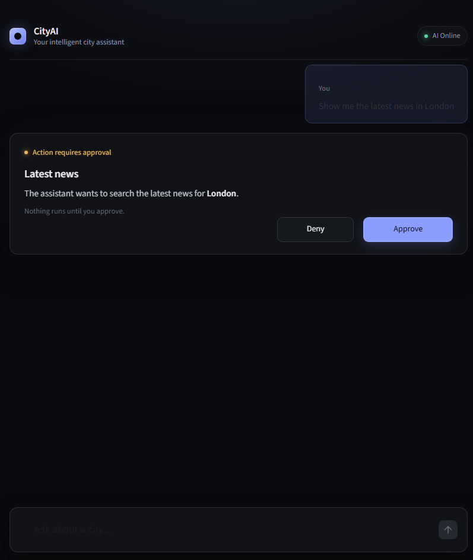

# LangChain AI Agent Automation

A learning project for understanding and building **AI Agents with LangChain**.

This project covers the progression from creating tools and tool calling to building an automated agent with `create_agent`, human-in-the-loop approval, real-world APIs, and a Streamlit frontend.


##  Preview



---


This project focuses on the core concepts required to understand AI Agents:

- Creating tools
- Built-in tools
- Custom tools
- Tool calling
- Tool binding
- Connecting tools with an agent
- Human-in-the-loop
- LangChain `create_agent`
- Agent automation
- Real API integration
- Streamlit AI frontend

---

##  Learning Flow

```text
AI Agent Fundamentals
        │
        ▼
Creating Tools
        │
        ▼
Built-in Tools
        │
        ▼
Custom Tools
        │
        ▼
Tool Calling
        │
        ▼
Tool Binding
        │
        ▼
Tools + Agent
        │
        ▼
Human-in-the-Loop
        │
        ▼
LangChain create_agent
        │
        ▼
Agent Automation
        │
        ▼
Real API Integration
   ┌────┴─────┐
   ▼          ▼
Weather      News
   │          │
   └────┬─────┘
        ▼
   Streamlit UI